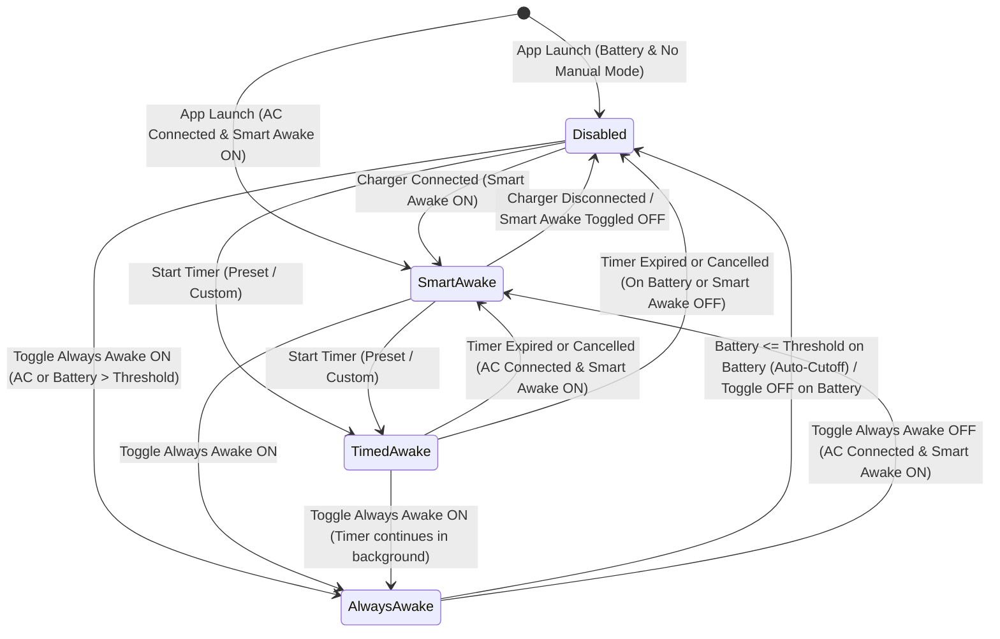

# 01 — Product and Feature Audit

- **Sector Score:** **3.0 / 5**
- **Confidence:** High
- **Evidence Coverage:** Static Inspection (`Sources/MacPulseNative/*.m`), Automated Local Verification (`--selftest`, `Tests/`), Runtime Verification (`PID 16618`, `pmset -g assertions`)
- **Unresolved Findings:** 4 (`SCOPE-001` [P1], `POWER-001` [P1], `SCOPE-002` [P2], `UX-001` [P2])
- **NOT VERIFIED Requirements:** 2 (Physical charger transition timing; physical low-battery discharge cutoff on unplugged MacBook)

---

## 1. Feature Inventory & Canonical Scope Alignment

The table below maps every feature present in the shipped binary (`Sources/MacPulseNative/`) against the Canonical Product Scope (§3.1–§3.10).

| Canonical Section | Feature | Canonical Requirement | Actual Implementation (`Sources/MacPulseNative/`) | Alignment Status |
|---|---|---|---|---|
| **§3.1** | Smart Awake | Prevent idle system sleep on AC; release on battery; handle startup, failures, and desktop Macs | `MPPowerSourceMonitor.m` (lines 89–160) + `MPPriorityArbiter.m` (lines 106–113) + `MPPowerManager.m` (lines 76–103) | **Implemented** (Physical unplug transition **NOT VERIFIED**) |
| **§3.2** | Enable/Disable Control | Simple control to enable/disable automatic behavior; obvious effective state; no stale assertions | `MPStatusMenuController.m` lines 145–149 (`"Keep Awake While Charging"`, `Cmd+C`) toggles `settings.keepAwakeWhileCharging` | **Partial** — Wording differs from `"Smart Awake"` (`UX-001`); `--selftest` corrupts setting (`QA-001`) |
| **§3.3** | Dynamic Menu-Bar Status | Clear active/inactive states; distinguish modes (`bolt.fill`, `bolt.slash`, `sun.max.fill`, `timer`); template icons | `MPPriorityArbiter.m` lines 126–144 + `MPStatusMenuController.m` lines 343–353 (`image.template = YES`) | **Implemented** |
| **§3.4** | Live Power Status | Show AC Power or Battery; show battery % when available; desktop Mac has no `-1%` display | `MPStatusMenuController.m` lines 371–373 (`Power Source: AC Power (100%)`, hides `%` when `batteryPercentage < 0`) | **Implemented** |
| **§3.5** | Normal Display Sleep | **Display must sleep normally.** No independent display-sleep toggle or `PreventUserIdleDisplaySleep` assertion | `MPPowerManager.m` lines 105–134 creates `kIOPMAssertionTypePreventUserIdleDisplaySleep`; menu item `"Allow Display Sleep"` (`Cmd+D`) exposed | **VIOLATION (`SCOPE-001` [P1])** — Out-of-scope feature implemented and shipped |
| **§3.6** | Launch at Login | Optional startup via `SMAppService.mainApp`; accurate status; understandable failure handling | `MPStatusMenuController.m` lines 14–54 (`MPLoginItemManager`) + lines 203–207 | **Partial** — Silent failure when `SMAppServiceStatusRequiresApproval` (`UX-002`); duplicate app bundles confuse registration (`REL-002`) |
| **§3.7** | Timed Awake | Presets: 30m, 1h, 2h; live countdown; cancel; revert to Smart Awake on expiry; clean teardown | `MPTimedAwakeManager.m` + `MPStatusMenuController.m` lines 230–333 (7 presets: 15m–8h + `Custom Duration...` modal) | **Implemented + Scope Expansion** — Uses wall-clock `NSDate` instead of monotonic clock (`POWER-003`) |
| **§3.8** | Always Awake | Manual override on AC or battery; clear active & battery-cutoff communication; immediate cancel | `MPStatusMenuController.m` lines 158–162 + `MPPriorityArbiter.m` lines 81–94 | **Defective Cutoff Notification (`POWER-001` [P1])** — Re-entrancy clears `isBatteryCutoffActive` and UI never shows cutoff state |
| **§3.9** | Advanced Battery Protection | Expandable settings; enabled by default; default 20%; configurable 10%–50%; safe invalid reading handling | `MPStatusMenuController.m` lines 165–176 (`Battery Safety Threshold` submenu: 10%–80%); `MPAppSettings.m` lines 89–91 | **Divergent (`SCOPE-002` [P2])** — Missing enable/disable protection toggle; submenu offers 60/70/80%; settings lack `[10, 50]` clamping |
| **§3.10** | Assertion Lifecycle | Single effective controller; no duplicate assertions; clean teardown on mode change, cancel, expiry, quit | `MPPriorityArbiter.m` + `MPPowerManager.m` + `main.m` lines 28–31 | **Implemented** (Callback overwrite bug `POWER-002` [P1] between Controller and Arbiter) |

---

## 2. Detailed Feature & Scope Findings

### 2.1 Out-of-Scope Display Sleep Prevention (`SCOPE-001` — P1)

Canonical requirement §3.5 explicitly mandates:
> *"The display must be allowed to sleep normally. There should not be an independent display-sleep prevention feature in the intended minimal product... A separate display-sleep toggle or unnecessary `PreventUserIdleDisplaySleep` assertion is outside the intended product scope."*

**Evidence in Repository:**
- `Sources/MacPulseNative/MPAppSettings.h` (line 14) and `MPAppSettings.m` (lines 10, 63–65, 86–87, 114–120) persist `allowDisplaySleep`.
- `Sources/MacPulseNative/MPPowerManager.m` (lines 105–134) creates and releases `kIOPMAssertionTypePreventUserIdleDisplaySleep` via `_displayAssertionID`.
- `Sources/MacPulseNative/MPPriorityArbiter.m` (line 122) computes `BOOL preventDisplay = (preventSystem && !self.settings.allowDisplaySleep);`.
- `Sources/MacPulseNative/MPStatusMenuController.m` (lines 179–183) adds the `"Allow Display Sleep"` menu item (`Cmd+D`).
- `Sources/MacPulseNative/MPAboutWindowController.m` (lines 88–91) lists `"Allow Display Sleep"` as one of the 5 core product features.
- Root Cause: An earlier review document (`docs/ENGINEERING_REVIEW_01.md`, lines 57–74, `Issue C-01`) mistakenly flagged the inert `allowDisplaySleep` stub as a "critical defect" and instructed developers to wire up `kIOPMAssertionTypePreventUserIdleDisplaySleep`, directly contradicting `docs/SPEC.md` line 46 (*"MacPulse avoids `kIOPMAssertionTypePreventUserIdleDisplaySleep` so the screen can turn off cleanly on timeout"*).

**Recommendation (Classification: Required Fix):**
Remove the `"Allow Display Sleep"` menu item from `MPStatusMenuController.m`, remove `allowDisplaySleep` from `MPAppSettings`, remove `_displayAssertionID` and `kIOPMAssertionTypePreventUserIdleDisplaySleep` from `MPPowerManager`, and update `MPAboutWindowController.m` and `README.md` to state that MacPulse always allows normal display sleep to protect display longevity and screen-lock security.

---

### 2.2 Mode Priority Hierarchy, Ambiguities & State Transitions (§3.2, §3.8, §3.10)

The implemented hierarchy in `MPPriorityArbiter.m` (`evaluateEffectiveState`, lines 68–153) is:

$$\text{Always Awake (Battery Safe)} \succ \text{Timed Awake} \succ \text{Smart Awake (AC)} \succ \text{Disabled}$$

#### Identified Behavioral Defects & Ambiguities:

1. **Synchronous Re-Entrancy & Lost Cutoff State (`POWER-001` — P1):**
   In `MPPriorityArbiter.m` lines 82–94:
   ```objc
   if (self.settings.alwaysAwake) {
       if (isPortableOnBattery && battery >= 0 && battery <= threshold) {
           cutoff = YES;
           self.settings.alwaysAwake = NO; // Posts kMPAppSettingsDidChangeNotification synchronously!
           effectiveMode = MPActiveModeDisabled;
       } ...
   }
   _isBatteryCutoffActive = cutoff;
   ```
   When `self.settings.alwaysAwake = NO` executes on line 85, `MPAppSettings.m` line 111 synchronously posts `kMPAppSettingsDidChangeNotification`. `MPPriorityArbiter` observes this notification (`handleSettingsChanged:`, line 51) and recursively calls `[self evaluateEffectiveState]` before line 94 is reached. In the inner call, `self.settings.alwaysAwake` is now `NO`, so the inner call sets `_isBatteryCutoffActive = NO` and notifies the UI; then the outer call resumes, sets `_isBatteryCutoffActive = YES`, and notifies the UI a second time. Worse, on the very next menu open (`menuWillOpen:` calls `evaluateEffectiveState` at `MPStatusMenuController.m` line 437), `alwaysAwake` is `NO`, so `_isBatteryCutoffActive` is overwritten to `NO` before the menu is even drawn! And `MPStatusMenuController.m` never reads `isBatteryCutoffActive` at all.

2. **Timed Awake Ignores Battery Safety Cutoff (Policy Ambiguity):**
   In `MPPriorityArbiter.m` lines 97–104, `Tier 2: Timed Awake` does **not** check `battery <= threshold`. If a user starts a 2-hour or 8-hour Timed Awake session on battery (or unplugs during a timed session) and battery drops below the safety threshold (e.g., 15%), Timed Awake keeps holding `PreventUserIdleSystemSleep` until hardware critical battery sleep (~1–2%). Even more subtly: if both `Always Awake` and `Timed Awake` are active on battery and battery hits 20%, `Always Awake` cuts off (`alwaysAwake = NO`), and `evaluateEffectiveState` immediately falls through to line 100 (`if (effectiveMode == MPActiveModeDisabled && isTimedActive)`), keeping the Mac awake under `Timed Awake` despite the battery safety tripwire!
   - **Recommended Deterministic Policy:** Either (a) apply the battery safety cutoff to both manual modes (`Always Awake` and `Timed Awake`) when running on battery at or below threshold, or (b) automatically cancel any background `Timed Awake` session when the user explicitly enables `Always Awake` so the two manual modes are mutually exclusive. Making `Always Awake` and `Timed Awake` mutually exclusive (enabling `Always Awake` cancels any running timer; starting a `Timed Awake` session turns off `Always Awake`) eliminates hidden background timers and prevents `Timed Awake` from defeating the `Always Awake` battery cutoff.

3. **Global Enable/Disable vs. Automatic Smart Awake Toggle (§3.2):**
   Currently, `"Keep Awake While Charging"` (`keepAwakeWhileCharging`) only controls Tier 3 (`Smart Awake`), while `Timed Awake` and `Always Awake` remain available when `keepAwakeWhileCharging` is `NO`. This is sensible and matches user expectations (a user who disables automatic AC keep-awake may still want an on-demand 30-minute timed session), provided the menu item is clearly named `"Smart Awake (While Charging)"`.

---

### 2.3 State Transition Table & Diagram

#### Current Implemented State Table (`MPPriorityArbiter.m`)

| `alwaysAwake` | `isTimedActive` | `keepAwakeWhileCharging` | Power Source (`isAC \|\| isDesktop`) | Battery vs Threshold (`battery <= threshold`) | Effective Mode (`currentMode`) | `PreventUserIdleSystemSleep` | Menu Icon |
|---|---|---|---|---|---|---|---|
| `YES` | Any | Any | AC / Desktop | Any | `MPActiveModeAlwaysAwake` | `YES` | `sun.max.fill` |
| `YES` | Any | Any | Battery | `battery > threshold` (or `-1`) | `MPActiveModeAlwaysAwake` | `YES` | `sun.max.fill` |
| `YES` -> auto `NO` | `NO` | Any | Battery | `0 <= battery <= threshold` | `MPActiveModeDisabled` (Cutoff) | `NO` | `bolt.slash` |
| `YES` -> auto `NO` | `YES` | Any | Battery | `0 <= battery <= threshold` | `MPActiveModeTimedAwake` *(Ambiguity!)* | `YES` | `timer` |
| `NO` | `YES` | Any | Any | Any | `MPActiveModeTimedAwake` | `YES` | `timer` |
| `NO` | `NO` | `YES` | AC / Desktop | Any | `MPActiveModeSmartAwake` | `YES` | `bolt.fill` |
| `NO` | `NO` | `YES` | Battery | Any | `MPActiveModeDisabled` | `NO` | `bolt.slash` |
| `NO` | `NO` | `NO` | Any | Any | `MPActiveModeDisabled` | `NO` | `bolt.slash` |



---

### 2.4 Evaluation of Additional / Non-Canonical Features (§16 Trade-Off Classification)

1. **Custom Timed Awake Duration Modal (`MPStatusMenuController.m` lines 248–265, 296–333) & Extra Presets (`15m, 45m, 4h, 8h`):**
   - **Classification:** **Optional enhancement** (already implemented; keep presets, simplify custom dialog if retained).
   - **Analysis:** Canonical §3.7 specifies `30m, 1h, 2h`. The extra presets (`15m, 45m, 4h, 8h`) add zero architectural complexity (just 4 dictionary entries in `presets`). The `Custom Duration...` modal (`promptCustomDuration`) uses a standard `NSAlert` with an `NSTextField` (37 lines of code). It solves a real user request (custom session length) with minimal code, though `[NSApp activateIgnoringOtherApps:YES]` at line 297 should be updated for macOS 14+ compatibility.
2. **Battery Threshold Options `60%, 70%, 80%` (`MPStatusMenuController.m` line 167):**
   - **Classification:** **UX improvement / Scope alignment (`SCOPE-002`).**
   - **Analysis:** Canonical §3.9 specifies `10%–50%` and an expandable Advanced Settings section with a Battery Protection enable/disable toggle. Having thresholds up to `80%` in a flat 8-item list makes it easy for a user to accidentally set a cutoff higher than their current battery level. Adding an explicit `"Enable Battery Protection"` toggle inside the submenu and validating thresholds in `MPAppSettings` (`clamped to [10, 80]` or canonical `[10, 50]`) resolves the ambiguity.
3. **Independent Display Sleep Toggle (`Allow Display Sleep`):**
   - **Classification:** **Do not add / Required removal (`SCOPE-001`).**
   - **Analysis:** Violates canonical requirement §3.5. Keeping the display awake prevents screen lock and wastes significant battery/panel power when MacPulse's core value proposition is keeping background tasks alive while allowing the screen to sleep normally.
