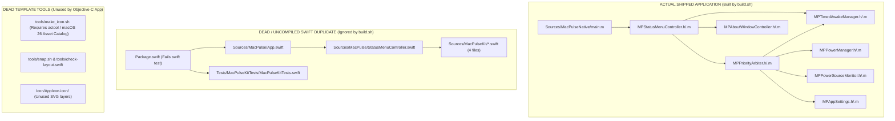

# 04 — Architecture and Code Quality Audit

- **Sector Score:** **2.5 / 5**
- **Confidence:** High
- **Evidence Coverage:** Static Inspection of 100% of `.h`, `.m`, `.swift`, `.sh`, and `.ts` files + Automated Stress Testing (`test_power_manager_stress`, `test_arbiter_exhaustive_matrix`, `test_debounce_stress`)
- **Unresolved Findings:** 6 (`ARCH-001` [P1], `POWER-001` [P1], `POWER-002` [P1], `QA-003` [P1], `POWER-003` [P2], `POWER-004` [P2])
- **NOT VERIFIED Requirements:** 0

---

## 1. Repository Architecture Map & Source of Truth

### 1.1 Actual Source of Truth vs. Dead/Duplicate Files

A critical architectural finding (`ARCH-001` — P1) is that the repository contains **two completely separate implementations** of MacPulse, plus leftover template scripts from an unrelated SwiftUI/SwiftData template (`CLAUDE.md`):



### 1.2 Complete File Inventory & Classification

| Path | Lines | Compiled in `build.sh`? | Classification | Notes |
|---|---:|---|---|---|
| `Sources/MacPulseNative/MPCommon.h` | 16 | Yes | **Production Source of Truth** | Defines `MPActiveMode` enum |
| `Sources/MacPulseNative/MPAppSettings.h/.m` | 152 | Yes | **Production Source of Truth** | `NSUserDefaults` wrapper |
| `Sources/MacPulseNative/MPPowerManager.h/.m` | 184 | Yes | **Production Source of Truth** | `IOPMAssertion` manager |
| `Sources/MacPulseNative/MPPowerSourceMonitor.h/.m` | 188 | Yes | **Production Source of Truth** | `IOPowerSources` runloop monitor |
| `Sources/MacPulseNative/MPPriorityArbiter.h/.m` | 197 | Yes | **Production Source of Truth** | Mode priority state machine |
| `Sources/MacPulseNative/MPTimedAwakeManager.h/.m` | 204 | Yes | **Production Source of Truth** | Countdown timer manager |
| `Sources/MacPulseNative/MPStatusMenuController.h/.m` | 462 | Yes | **Production Source of Truth** | `NSStatusItem` & `NSMenu` controller (also embeds `MPLoginItemManager`) |
| `Sources/MacPulseNative/MPAboutWindowController.h/.m` | 151 | Yes | **Production Source of Truth** | Floating `NSPanel` About window |
| `Sources/MacPulseNative/main.m` | 278 | Yes | **Production Source of Truth** | `MPAppDelegate` + `runSelfTests()` + `main()` |
| `Sources/MacPulse/*.swift` (2 files) | 229 | **No** | **Dead Duplicate (`ARCH-001`)** | Incomplete Swift AppKit UI (no Timed Awake, no Arbiter, no About window) |
| `Sources/MacPulseKit/*.swift` (4 files) | 249 | **No** | **Dead Duplicate (`ARCH-001`)** | Incomplete Swift library |
| `Tests/MacPulseKitTests/MacPulseKitTests.swift` | 57 | **No** | **Broken / Dead (`ARCH-001`)** | `swift test` fails to link `Package.swift` manifest |
| `Package.swift` | 25 | **No** | **Broken / Dead (`ARCH-001`)** | Unused by `build.sh`; fails `swift test` on CommandLineTools |
| `CLAUDE.md` | 52 | N/A | **Misleading Template Doc (`DOC-001`)** | Claims MacPulse is a SwiftUI + SwiftData app with `SettingsView.swift` and `Snapshot.swift` (which were deleted in Git!) |
| `tools/snap.sh`, `tools/check-layout.swift`, `tools/icon_review.sh`, `tools/icon_sheet.swift`, `tools/make_icon.sh` | — | **No** | **Dead Template Scripts** | Expect deleted Swift files (`Snapshot.swift`) or full Xcode `actool` |

---

## 2. Source-Level Engineering Review of `Sources/MacPulseNative/`

### 2.1 Module Boundaries & Responsibility Separation
The Objective-C codebase in `Sources/MacPulseNative/` is cleanly factored into 7 small classes (1,210 lines of `.m` implementation total). Memory management uses Automatic Reference Counting (`-fobjc-arc`), and Core Foundation calls in `MPPowerSourceMonitor.m` (`IOPSCopyPowerSourcesInfo`, `IOPSCopyPowerSourcesList`, `IOPSNotificationCreateRunLoopSource`) strictly obey the Core Foundation Create/Copy/Get ownership rule (`CFRelease` is called on every `Copy`/`Create` reference, and `Get` references are never over-released).

However, four concrete architectural and concurrency defects exist in the production Objective-C classes:

---

### 2.2 Defect 1: Synchronous Notification Re-Entrancy in `MPPriorityArbiter` (`POWER-001` — P1)

- **File:** `Sources/MacPulseNative/MPPriorityArbiter.m` (lines 25–28, 51–53, 68–95) and `Sources/MacPulseNative/MPAppSettings.m` (lines 106–112).
- **Mechanism:**
  1. `MPPriorityArbiter` registers as an observer for `kMPAppSettingsDidChangeNotification` in `initWithPowerManager:...` (line 25), calling `handleSettingsChanged:` -> `[self evaluateEffectiveState]` (line 52).
  2. Inside `evaluateEffectiveState`, when `self.settings.alwaysAwake` is `YES` and `isPortableOnBattery && battery >= 0 && battery <= threshold` (line 83), line 85 executes:
     ```objc
     cutoff = YES;
     self.settings.alwaysAwake = NO; // Disengage setting
     ```
  3. `-[MPAppSettings setAlwaysAwake:NO]` (in `MPAppSettings.m` line 111) synchronously posts `kMPAppSettingsDidChangeNotification` on the current thread before returning.
  4. `MPPriorityArbiter` synchronously re-enters `evaluateEffectiveState` in a nested stack frame where `self.settings.alwaysAwake` is now `NO`.
  5. The inner frame evaluates `cutoff = NO`, sets `_isBatteryCutoffActive = NO` (line 94), applies the `MPPowerManager` state, and fires `self.onStateChanged(self)` (line 151).
  6. Execution returns to line 86 of the outer frame, which overwrites `_isBatteryCutoffActive = YES`, re-applies `MPPowerManager` state, and fires `self.onStateChanged(self)` a second time.
  7. Then, whenever `evaluateEffectiveState` is called again (e.g., `menuWillOpen:` at `MPStatusMenuController.m` line 437), `self.settings.alwaysAwake` is `NO`, so `_isBatteryCutoffActive` is immediately wiped back to `NO`.
- **Remediation:**
  Add a boolean guard `_isEvaluating` (or update `alwaysAwake` without re-triggering `evaluateEffectiveState`), and track `_isBatteryCutoffActive` as sticky until either (a) AC power is connected, or (b) the user manually toggles `Always Awake` or `Timed Awake`.

---

### 2.3 Defect 2: `MPStatusMenuController` Overwrites `MPPriorityArbiter`'s Timer Callbacks (`POWER-002` — P1)

- **File:** `Sources/MacPulseNative/MPPriorityArbiter.m` (lines 38–49) and `Sources/MacPulseNative/MPStatusMenuController.m` (lines 98, 110–117).
- **Mechanism:**
  `MPTimedAwakeManager` defines single-cast block properties `onTick` and `onCompletion`.
  In `MPStatusMenuController.m` line 98:
  ```objc
  _arbiter.timedAwakeManager = _timedAwakeManager;
  ```
  Inside `-[MPPriorityArbiter setTimedAwakeManager:]` (`MPPriorityArbiter.m` lines 42–47), the arbiter assigns its own `onTick` and `onCompletion` blocks to `timedAwakeManager`.
  Immediately afterward, in `MPStatusMenuController.m` lines 110–117:
  ```objc
  _timedAwakeManager.onTick = ^(NSTimeInterval remaining) {
      [weakSelf updateUI];
  };
  _timedAwakeManager.onCompletion = ^(BOOL expired) {
      [weakSelf.arbiter evaluateEffectiveState];
      [weakSelf updateUI];
  };
  ```
  This **overwrites and destroys** the blocks registered by `MPPriorityArbiter`! As a result:
  - During a timed session, `MPPriorityArbiter` is never notified on ticks (so the assertion reason string in `MPPriorityArbiter.m` line 103 is never updated unless `evaluateEffectiveState` is called externally).
  - On timer completion, `MPStatusMenuController` manually calls `[weakSelf.arbiter evaluateEffectiveState]`, which triggers `_arbiter.onStateChanged` -> `[weakSelf updateUI]`, and then line 116 calls `[weakSelf updateUI]` a second time.
- **Remediation:**
  Keep `MPTimedAwakeManager.onCompletion` and `onTick` owned solely by `MPPriorityArbiter` (or use `NSNotificationCenter` / delegate broadcasting), and let `MPPriorityArbiter` notify `MPStatusMenuController` via `onStateChanged` / `onTimerTick`.

---

### 2.4 Defect 3: Multi-Threaded Property TOCTOU in `MPPowerManager` (`QA-003` — P1)

- **File:** `Sources/MacPulseNative/MPPowerManager.m` (lines 37–59); `Tests/tiers/tier5_adversarial/test_power_manager_stress.m` (lines 85–93).
- **Mechanism:**
  - In `MPPowerManager.m` lines 55–59:
    ```objc
    - (BOOL)createPreventSystemSleepAssertionWithReason:(nullable NSString *)reason {
        return [self applyStateWithSystemSleepPrevented:YES
                                 displaySleepPrevented:[self isDisplaySleepPrevented]
                                                reason:reason];
    }
    ```
    `[self isDisplaySleepPrevented]` acquires and unlocks `_lock`, and then `applyStateWithSystemSleepPrevented:...` acquires `_lock` again—a classic Time-of-Check to Time-of-Use (`TOCTOU`) race if called concurrently.
  - Similarly, in `test_power_manager_stress.m` lines 86–88:
    ```objc
    BOOL s = [pm isSystemSleepPrevented];
    BOOL d = [pm isDisplaySleepPrevented];
    if (!s && d) { ... }
    ```
    Because `isSystemSleepPrevented` and `isDisplaySleepPrevented` lock and unlock `_lock` separately, another thread can transition `(NO, NO) -> (YES, YES)` between the two property reads, causing the reader thread to observe `s == NO` and `d == YES`. During our independent audit run of `./build/bin/test_power_manager_stress`, this exact race fired and caused the test binary to exit with code `1` (`INVARIANT VIOLATION: Display sleep prevented while system sleep allowed!`).
  - Note: Removing the out-of-scope display sleep assertion (`SCOPE-001`) eliminates the dual-assertion state entirely; if a snapshot getter is ever needed, both booleans must be read under a single lock acquisition.

---

### 2.5 Defect 4: `MPPowerSourceMonitor` Debounce Cancellation Race (`POWER-004` — P2)

- **File:** `Sources/MacPulseNative/MPPowerSourceMonitor.m` (lines 36–54, 76–87).
- **Mechanism:**
  ```objc
  - (void)handleHardwareNotification {
      _isStopped = NO;
      dispatch_async(dispatch_get_main_queue(), ^{
          if (self->_isStopped) return;
          ...
  ```
  1. Line 37 unconditionally sets `_isStopped = NO;` before dispatching asynchronously to the main queue, without checking if the monitor was stopped.
  2. If `handleHardwareNotification` is invoked on a background thread (or synchronously before `stopMonitoring`), and `stopMonitoring` is called immediately afterward, `test_debounce_stress.m` lines 69–71 explicitly notes: `VULNERABILITY DETECTED [CHALLENGE-01]: Debounce callback fired after synchronous stopMonitoring (race between dispatch_async and stopMonitoring)` (and the test author suppressed the failure by not returning `1`!).
- **Remediation:**
  Remove `_isStopped = NO;` from `handleHardwareNotification` (only `startMonitoring` should set `_isStopped = NO`), and ensure `handleHardwareNotification` only schedules work when `_runLoopSource != NULL && !_isStopped` on the main queue.

---

### 2.6 Defect 5: Excessive `CFPreferencesAppSynchronize` Calls in `MPAppSettings`

- **File:** `Sources/MacPulseNative/MPAppSettings.m` (lines 58, 72–73, 77, 101–102, 109–110, 117–118, 125–126).
- **Mechanism:**
  Every property read in `reloadSettings` (called at the start of every `evaluateEffectiveState` in `MPPriorityArbiter.m` line 69!) calls `CFPreferencesAppSynchronize((__bridge CFStringRef)kBundleIdentifier)`. Every setter calls both `[[self userDefaults] synchronize]` (deprecated by Apple) and `CFPreferencesAppSynchronize`.
- **Why It Matters:** `NSUserDefaults` already caches preferences in memory and synchronizes asynchronously via `cfprefsd`. Calling `CFPreferencesAppSynchronize` on every `evaluateEffectiveState` performs unnecessary synchronous IPC to `cfprefsd` on the main UI thread.
